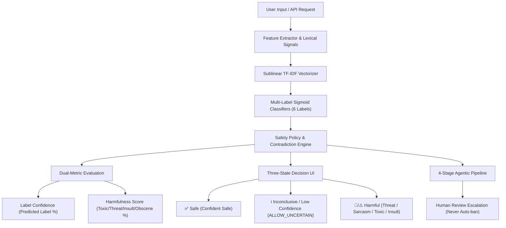
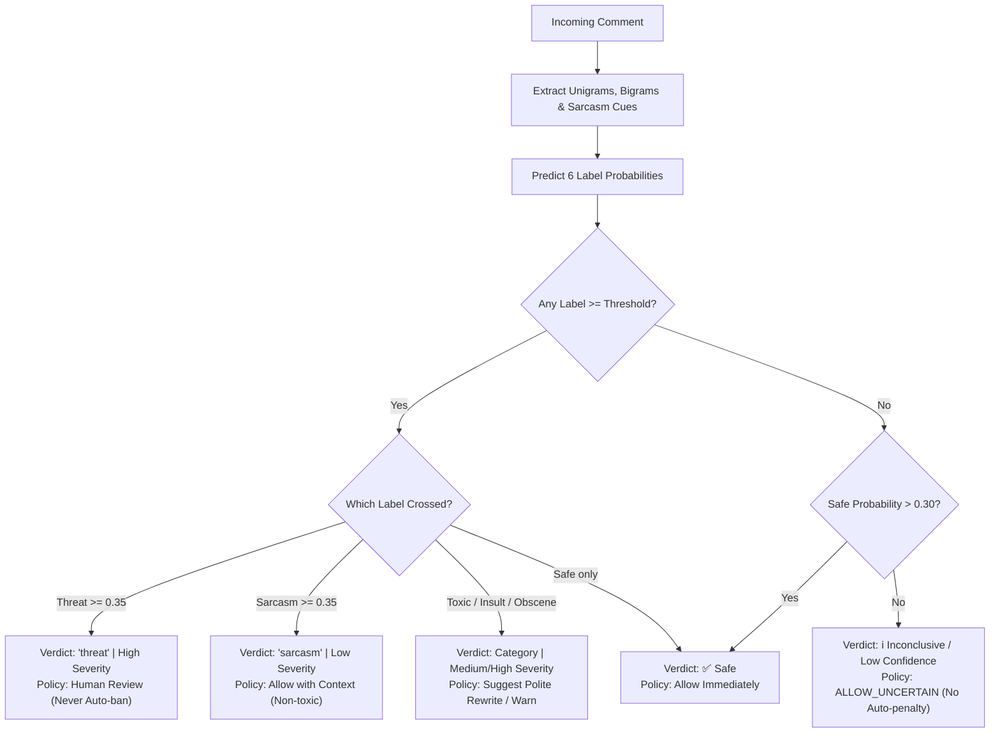
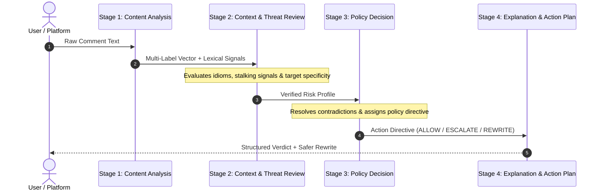

# CyberShield AI 🛡️

[](https://www.python.org/)
[](https://flask.palletsprojects.com/)
[](tests/)
[](LICENSE)

**CyberShield AI** is a real-time, multi-label cyberbullying detection and content moderation platform. It combines machine learning, safety-first escalation policies, an autonomous agentic moderation pipeline, explainable AI, and interactive analytics to identify harassment, threats, insults, and sarcasm online.

---

## 📐 System Architecture



---

## 🔄 Decision & Uncertainty Flowchart

The system separates classification probabilities, safety thresholds, and uncertainty handling to avoid false confidence claims on ambiguous inputs:



---

## 🤖 4-Stage Agentic Moderation Pipeline

For high-risk or ambiguous content, CyberShield AI activates an autonomous 4-stage pipeline for contextual analysis and transparent reasoning:



---

## 🌟 Key Capabilities

- **6-Label Multi-Label Schema**: Predicts independent probabilities for `safe`, `toxic`, `insult`, `threat`, `obscene`, and `sarcasm`.
- **Sarcasm vs. Toxicity Disentanglement**: Sarcasm is strictly decoupled from toxicity (`sarcasm != toxic`). Benign irony receives low severity without triggering toxicity penalties.
- **Safety-First Threat Policy**: Threat recall threshold is tuned to `0.35`. Threats trigger human moderation review (`FLAG_FOR_HUMAN_REVIEW`) and never automatic punitive bans.
- **Non-Threat Idiom Filters**: Idioms with violent words (e.g. *"kill time"*, *"battery is dying"*, *"died laughing"*) are recognized as benign idioms.
- **Dual-Metric Clarity**:
  - **Label confidence**: Classification probability of the predicted category (e.g. `90%` for sarcasm).
  - **Harmfulness score**: Strongest score among harmful categories (`threat`, `toxic`, `insult`, `obscene`), displaying `0%` for safe items and `1%`–`3%` for benign sarcasm.
- **Inconclusive Handling**: When no label crosses threshold and safe probability is low, the UI assigns an informational neutral badge (`ℹ️ Inconclusive / Low Confidence`) rather than a misleading green checkmark.
- **Word-Level Attribution & Safer Rewrites**: Highlights flagged tokens and generates constructive alternative rewrites.
- **Zero Binary Dependencies**: Pure Python inference using sublinear TF-IDF + Sigmoid logits with zero external binary or C++ runtime dependencies.
- **Zero-Downtime Rollback**: Instant rollback to the legacy V1 model via `CYBERSHIELD_MODEL_VERSION=v1`.

---

## 🏗️ Project Structure

```
cybershield-ai/
├── app.py                      # Flask web application & REST API
├── predictor.py                # Inference engine & decision policies
├── agent.py                    # 4-stage autonomous moderation pipeline
├── train_multi_label.py        # Reproducible training pipeline for Model V2
├── validate_dataset.py         # Dataset schema and matrix validator
├── requirements.txt            # Python dependencies
│
├── data/
│   ├── synthetic_comments_v2.json  # Multi-label dataset (V2 training data)
│   ├── history.json                # Moderation activity log
│   └── dataset_quality_report_v2.md# Dataset quality & balance report
│
├── model/
│   ├── cybershield_v2.json     # Trained Model V2 artifact (vocab, weights, biases)
│   └── cybershield.json        # Preserved Legacy Model V1 artifact
│
├── static/
│   ├── css/style.css           # Premium dark theme and responsive layout
│   └── js/
│       ├── analyzer.js         # Interactive analyzer frontend & agent visualization
│       └── dashboard.js        # Analytics charts and activity table
│
├── templates/
│   ├── index.html              # Landing page
│   ├── analyzer.html           # Live text analyzer & agent UI
│   └── dashboard.html          # Analytics dashboard
│
└── tests/
    ├── test_dataset_validation.py  # Dataset schema tests (12 tests)
    └── test_multi_label_model.py   # Predictor & API regression tests (26 tests)
```

---

## 🚀 Quick Start

### 1. Clone & Setup
```bash
git clone https://github.com/pradnya-182006/cybershield-ai.git
cd cybershield-ai

# Create & activate virtual environment
python -m venv .venv
.venv\Scripts\activate      # On Windows
source .venv/bin/activate   # On macOS/Linux

# Install dependencies
pip install -r requirements.txt
pip install pytest
```

### 2. Run the App
```bash
python app.py
```
Open **`http://127.0.0.1:5000`** in your browser.

- **Analyzer**: `http://127.0.0.1:5000/analyzer`
- **Dashboard**: `http://127.0.0.1:5000/dashboard`

---

## 📡 API Reference

### Analyze Text
`POST /api/analyze`

**Request:**
```json
{
  "text": "I absolutely love waiting an hour for a five-minute meeting."
}
```

**Response:**
```json
{
  "label": "sarcasm",
  "label_confidence": 0.9018,
  "harmfulness_score": 0.013,
  "severity": "low",
  "uncertain": false,
  "predicted_labels": ["sarcasm"],
  "scores": {
    "safe": 0.0539,
    "toxic": 0.0126,
    "insult": 0.0088,
    "threat": 0.0049,
    "obscene": 0.0079,
    "sarcasm": 0.9018
  },
  "explanation": "Contextual sarcasm detected without active toxicity. Sarcasm is context-dependent and reviewed separately.",
  "moderation_policy": {
    "action": "ALLOW_WITH_CONTEXT",
    "priority": "LOW",
    "reason": "Sarcastic language detected without active toxicity."
  },
  "safer_rewrite": "I have concerns regarding this matter and would like to address them directly and constructively.",
  "tone_tags": ["Sarcastic"],
  "model_version": "2.0.0"
}
```

### Run Agent Pipeline
`POST /api/agent` (Runs the full 4-stage contextual analysis and returns stage timings, policy decisions, and audit trail).

---

## 🧪 Testing

Run the automated test suite:
```bash
python -m pytest -v
```
All **38 test cases** pass across dataset validation, multi-label inference, threat recall, sarcasm separation, and uncertainty preservation.

---

## 📄 License

This project is licensed under the MIT License — see the [LICENSE](LICENSE) file for details.
